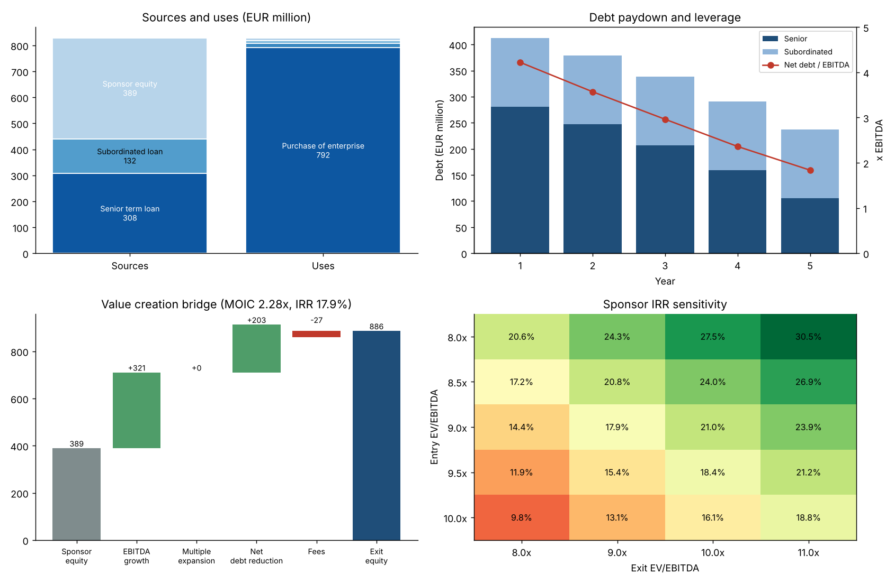

# Mini LBO Model

Simplified leveraged buyout model in Python: sources and uses, debt schedule with cash sweep, sponsor IRR and MOIC, value creation bridge and entry / exit sensitivities.



## What it does

- **Sources and uses**: purchase price, transaction and financing fees, cash to balance sheet; sponsor equity is the balancing item
- **Operating forecast**: revenue growth and EBITDA margin per year, D&A, capex, change in working capital, taxes after interest
- **Debt schedule**: senior term loan with mandatory amortisation and a cash sweep, subordinated bullet loan, minimum cash floor, flag when cash flow cannot cover mandatory repayments
- **Credit metrics**: net debt / EBITDA and interest cover each year
- **Returns**: exit enterprise value, net debt at exit, exit equity, **MOIC** and **IRR**
- **Value creation bridge**: equity gain split into EBITDA growth, multiple expansion, net debt reduction and fees (sums exactly to the gain)
- **Sensitivities**: IRR and MOIC for entry multiple x exit multiple, and IRR for exit year x exit multiple

## Sample result (fictional deal, EUR million)

| | |
|---|---|
| Entry | 9.0x LTM EBITDA of 88, enterprise value 792 |
| Financing | Senior 3.5x (308), subordinated 1.5x (132), sponsor equity 389 (47%) |
| Exit (year 5, 9.0x) | Enterprise value 1,113, net debt 227, equity 886 |
| Returns | **MOIC 2.28x, IRR 17.9%** |
| Leverage | 4.2x in year 1 falling to 1.8x in year 5 |

With no multiple expansion, returns come from EBITDA growth (+321) and net debt reduction (+203), less fees (-27).

## Quick start

```bash
pip install -r requirements.txt
python -m minilbo --input data/sample_deal.json --out docs/lbo_overview.png
pytest
```

To model another deal, copy `data/sample_deal.json` and change the figures.

## Project structure

```
minilbo/model.py        Sources and uses, projections, returns, bridge, sensitivities
minilbo/report.py       Four-panel chart
minilbo/__main__.py     Command line entry point
data/sample_deal.json   Fictional deal inputs
tests/                  Unit tests (closed-form checks, IRR, bridge identity, sensitivity direction)
```

## Modelling notes

- Interest is charged on opening balances, which avoids circular references (slightly overstates interest when debt is repaid during the year).
- IRR assumes a single equity outflow at entry and a single inflow at exit, so it equals MOIC^(1/years) - 1; the generic `irr()` function handles interim cash flows.
- Tests include an unlevered flat-business case where exit equity must equal entry value plus accumulated free cash flow, and an identity check that the bridge sums to the equity gain.

## Limits

- The target and the deal are **fictional** and illustrative.
- Simplifications: financing fees are not amortised for tax, no management rollover or option pool, no interim dividends, no revolver, no interest income on cash.

## Stack

Python · pandas · NumPy · SciPy · Matplotlib · pytest
